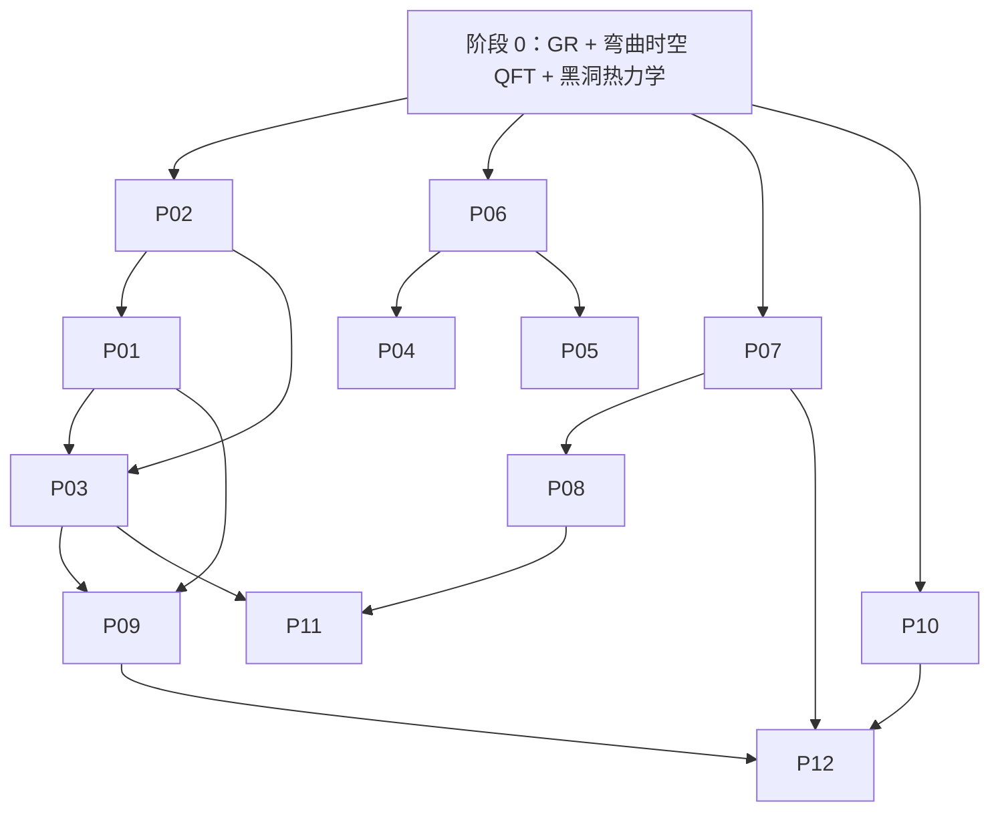

# 问题索引

12 个前沿问题，5 条主线，1 个目的：**让问题决定你学什么**。

## 索引表

| ID | 问题 | 主线 | 难度 | 状态 | 前置 |
|---|---|:--:|:--:|:--:|---|
| [P01](P01-black-hole-information.md) | 黑洞信息悖论 | A 信息与全息 | ★★★★☆ | `candidate` | Hawking 辐射、纠缠熵 |
| [P02](P02-holography.md) | 全息原理与 AdS/CFT | A 信息与全息 | ★★★☆☆ | `candidate` | QFT、CFT |
| [P03](P03-emergent-spacetime.md) | 时空从纠缠中涌现 | A 信息与全息 | ★★★★☆ | `open` | AdS/CFT、张量网络 |
| [P04](P04-string-theory.md) | 弦论作为引力的紫外完备 | B 紫外完备 | ★★★★★ | `contested` | QFT、超对称 |
| [P05](P05-loop-quantum-gravity.md) | 圈量子引力与离散时空 | B 紫外完备 | ★★★★☆ | `contested` | ADM、规范理论 |
| [P06](P06-uv-completion-landscape.md) | 紫外完备的光谱与判据 | B 紫外完备 | ★★★☆☆ | `contested` | 重整化 |
| [P07](P07-cosmological-constant.md) | 宇宙学常数与 de Sitter | D 宇宙学 | ★★★☆☆ | `open` | GR、QFT 真空能 |
| [P08](P08-cosmic-origins.md) | 宇宙的起源与初始条件 | D 宇宙学 | ★★★☆☆ | `open` | FRW、暴胀 |
| [P09](P09-singularities.md) | 奇点与黑洞内部 | C 时空的量子性质 | ★★★☆☆ | `open` | 因果结构 |
| [P10](P10-gravity-quantum-superposition.md) | 引力与量子叠加 | C 时空的量子性质 | ★★☆☆☆ | `open` | 量子力学 |
| [P11](P11-problem-of-time.md) | 时间问题与量子参考系 | C 时空的量子性质 | ★★★☆☆ | `open` | 正则量子化 |
| [P12](P12-phenomenology.md) | 量子引力现象学与检验 | E 检验 | ★★☆☆☆ | `open` | 粒子物理、引力波 |

> 状态：`open` 未解决 · `candidate` 有强候选答案 · `contested` 多方案竞争 · `settled` 已解决（可当背景）

## 依赖图



## 推荐顺序（三条不同的入口）

**入口 A · 信息路线**（最推荐，正反馈最强）
```
P02 → P01 → P03 → P09 → P11
```

**入口 B · 理论路线**（想做 UV 完备）
```
P06 → P04（或 P05）→ P01 → P03
```

**入口 C · 现象学路线**（想靠近实验）
```
P12 → P10 → P01 → P07
```

## 全局阅读约定

- 每个档案的"必读文献"按**难度递增**排列，第一篇永远是最值得先读的。
- "进入路径"里的周数是**估计值**，不是承诺；卡住超过 2 周就往前走。
- "自检问题"不是练习，是**通关条件**。答不出就说明还没到下一阶段。
